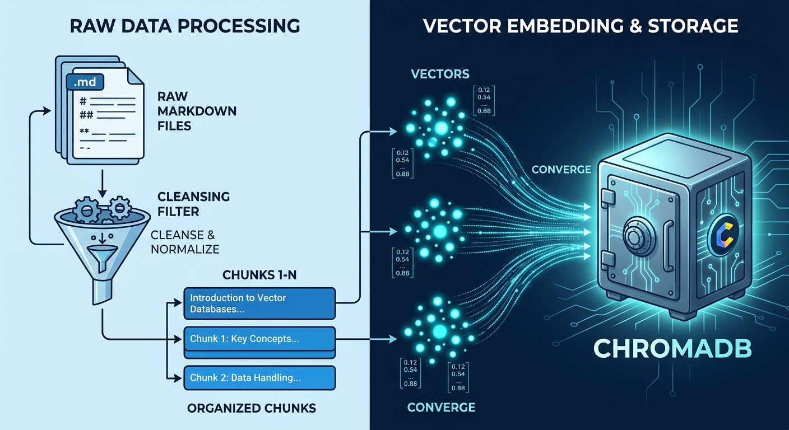
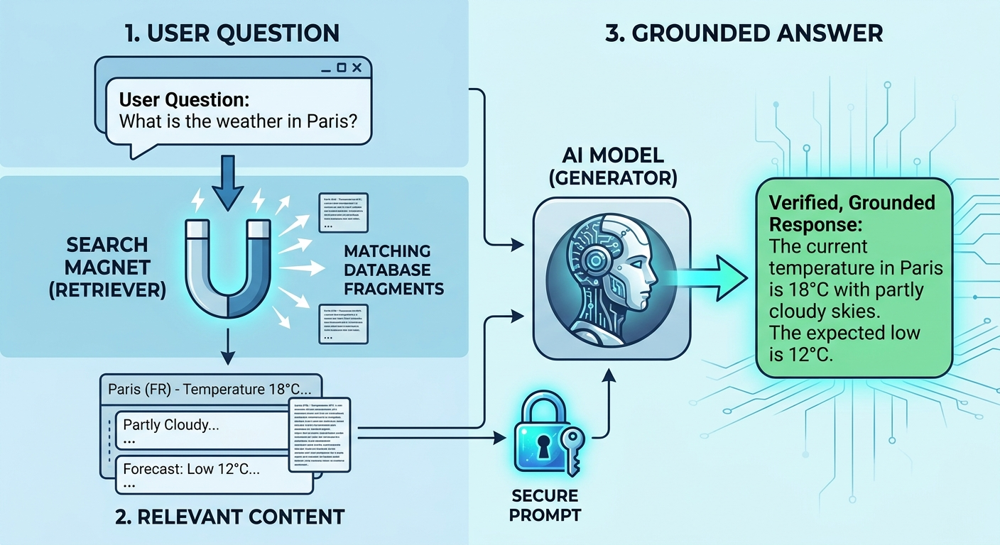
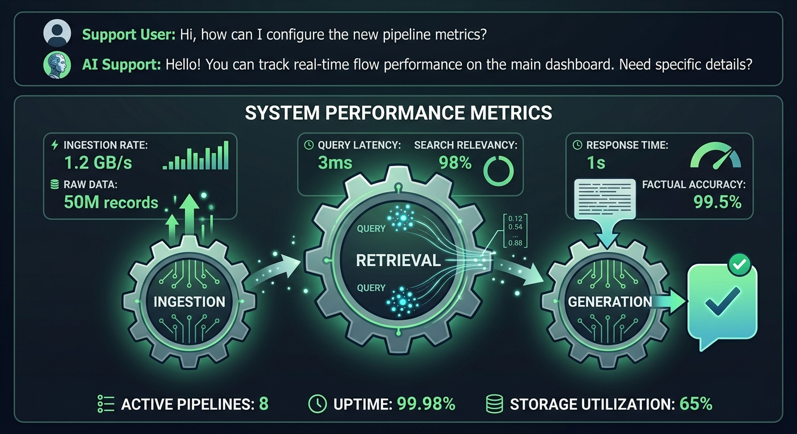

## Foundations, Ingestion, and Vectorization

- **Key Phrases:** *"Building the Northstar Knowledge Base Foundation"*, *"Automated Ingestion and 500-Word Chunking"*, *"Local Vector Store via ChromaDB"*

The project established a technical foundation for the Northstar support platform. Markdown files from the knowledge base were systematically scanned, cleaned, and segmented using an optimized chunk size of 500 words and a sliding overlap of 50 words to maintain semantic continuity. 

These processed chunks were persisted into `data/processed_chunks.jsonl`. Subsequently, the local vector store was implemented using ChromaDB and the `all-MiniLM-L6-v2` embedding model, successfully vectorizing all documents for semantic indexing.

---

## Semantic Retrieval and Generative Integration

- **Key Phrases:** *"Precision Similarity Search"*, *"Strict Grounding to Prevent Hallucinations"*, *"Mistral LLM Integration"*

Phase 3 introduced the semantic retriever, enabling the system to query the vector database and extract relevant chunks using vector similarity. 

Building upon this, Phase 4 integrated the Mistral generative model (`ministral-14b-latest`) via an OpenAI-compatible interface. A strict system prompt was enforced, ensuring the LLM answered user queries using *only* the retrieved context. If information was missing, the assistant safely declined rather than hallucinating, providing a professional and secure operational workflow.

---

## End-to-End Pipeline and Interactive Deployment

- **Key Phrases:** *"Unified Master Script"*, *"Interactive Support Chat Experience"*, *"Scalable Python Architecture"*

The final phase unified all components into a comprehensive end-to-end master script (`rag_pipeline.py`). This script orchestrates the entire workflow: loading embeddings, connecting to ChromaDB, querying Mistral, and running an interactive console session for support operators. 

The assistant successfully handles real-time technical queries regarding account access, policies, and troubleshooting while maintaining strict traceability and robust error handling. The project is fully complete, modular, and structured entirely within the `scripts/` directory.